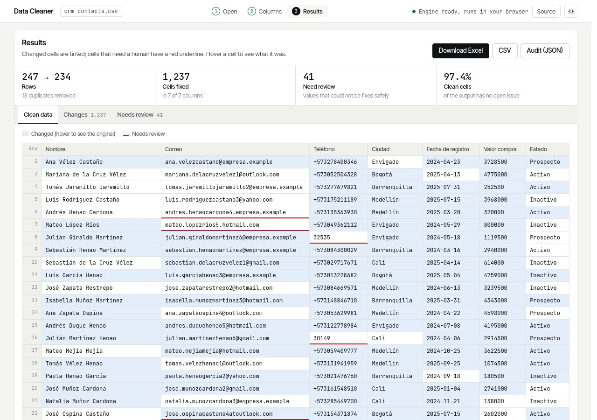

# Data Cleaner

[](https://github.com/JoseMayo16/data-cleaner/actions/workflows/ci.yml)

**Clean messy CSV and Excel files in your browser, with a record of every change.**

Exports from CRMs, forms and point-of-sale systems arrive with duplicate rows, five spellings
of the same city, `N/A` in empty cells, emails in capitals with typos in the domain, phones and
dates in every format. This tool fixes what can be fixed safely, flags what can't, and lists
every single change so nothing happens behind your back.

**Live demo: https://josemayo16.github.io/data-cleaner/** (no sign-up, no upload: the file is
processed inside your browser tab). To jump straight to the results with a messy sample, open
[`?sample=crm-contacts.csv&run=1`](https://josemayo16.github.io/data-cleaner/?sample=crm-contacts.csv&run=1).



On the bundled CRM sample (247 rows, Spanish, semicolon CSV) it fixes 1,237 cells, removes 13
duplicate rows and leaves 41 values for a person to review, such as `andres.henaocardona4.empresa.example`
(no `@`) or a five-digit phone number.

## What it fixes

| Column type | Example in | Example out |
|---|---|---|
| Any | `"  Ana   María "` (extra and non-breaking spaces), `N/A`, `-`, `null` | `Ana María`, empty |
| Email | ` Ana.Perez@GMIAL.com. ` | `ana.perez@gmail.com` |
| Phone (default country) | `(57) 300-123-4567`, `300 123 4567` | `+573001234567` |
| Date | `25/03/2024`, `3 de marzo de 2024`, `Mar 3, 2024`, Excel serial `45000` | `2024-03-25` |
| Number | `$ 1.234.567,50`, `USD 1,234.50`, `(1.200)` | `1234567.5`, `1234.5`, `-1200` |
| Person name | `MARIA DE LOS ANGELES` | `Maria de los Angeles` |
| Category | `bogota`, `BOGOTÁ`, `Bogota` | `Bogotá` |
| Whole row | the same customer typed twice | removed or flagged, with the row it repeats |

Column types are detected from the header (English and Spanish) and confirmed by the values; you
can override any guess. Date order (31/12 vs 12/31) and decimal separator (1.234,5 vs 1,234.5)
are detected per column from values that can only be read one way, with the country as fallback.

What can't be fixed safely is never guessed: an impossible date (`31/02/2024`), a phone with
the wrong length, an email without `@`, or two different rows sharing an email all go to the
**Needs review** list with their spreadsheet row number.

## Outputs

- **Excel** with three sheets: `Cleaned` (numbers and dates as real Excel types), `Issues` and
  `Changes` (row, column, before, after, rule).
- **CSV** in UTF-8 with BOM, so Excel opens accents correctly.
- **Audit JSON** with the same information, for pipelines.

## How it works

```
 browser tab                                         command line
 ───────────                                         ────────────
 index.html ── worker.js (module Web Worker)          data-cleaner clean in.xlsx -o out.xlsx
                  │                                          │
                  ▼                                          │
            Pyodide (CPython 3.14 in WebAssembly)            │
                  │  micropip installs site/wheels/*.whl     │
                  ▼                                          ▼
          ┌──────────────── data_cleaner (same package) ────────────────┐
          │ table.py   read CSV (encoding, delimiter) / XLSX, write both  │
          │ detect.py  column kinds, date order, decimal separator        │
          │ rules.py   one pure function per fix                          │
          │ cleaner.py apply rules, dedupe, keep the audit trail          │
          └───────────────────────────────────────────────────────────────┘
```

- **No server and no upload.** The page is static (GitHub Pages); the Python engine runs in a
  Web Worker so the page stays responsive while it works.
- **One engine, two front ends.** The browser installs the same wheel that the tests and the CLI
  use, so what is tested is exactly what runs on the page.
- **No pandas, on purpose.** The engine is standard-library Python plus openpyxl. pandas and
  numpy would add about 8 MB to the first page load (around 60% more) for no gain at these sizes.

## Command line

```bash
python -m venv .venv
.venv/bin/pip install -e ".[dev]"

.venv/bin/data-cleaner profile samples/crm-contacts.csv
.venv/bin/data-cleaner clean samples/crm-contacts.csv -o clean.xlsx --report audit.json
.venv/bin/data-cleaner clean samples/sales-orders.xlsx -o clean.csv --country US --allow-repeats
```

Options: `--country` (phone prefix and defaults), `--date-order auto|DMY|MDY`,
`--decimal auto|,|.`, `--duplicates remove|flag|keep`, `--kind "Column=phone"` to override a
detected type, `--allow-repeats` for transaction tables where a customer appears many times.

## Run the web page locally

```bash
.venv/bin/python scripts/build_site.py   # builds the wheels the page installs
python -m http.server 8000 --directory site
```

## Tests

```bash
.venv/bin/pytest
.venv/bin/ruff check . && .venv/bin/ruff format --check .
```

60 tests cover every rule with edge cases (Excel serial dates, impossible dates, negative numbers
in parentheses, national trunk prefixes, names with particles and apostrophes), column detection,
CSV encodings and delimiters, typed Excel output, the CLI, the browser bridge, and both sample
files end to end.

## Samples

`scripts/make_samples.py` generates `crm-contacts.csv` (Spanish CRM export) and
`sales-orders.xlsx` (US orders). Every name, email and phone number is invented.

## License

MIT
